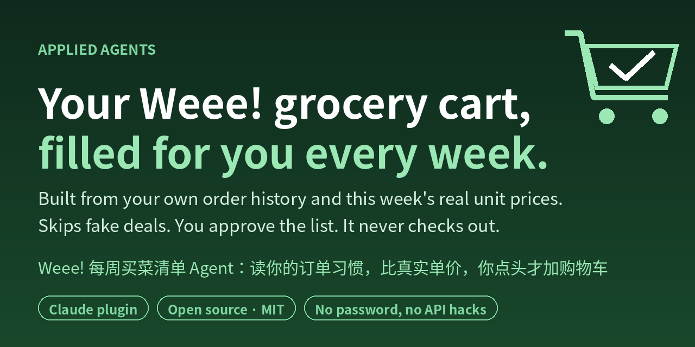

<p align="center">
  
</p>

# Applied Agents

**Practical AI agents for real life and real work, built and used by a cloud architect.** Each one solves a real problem I had, runs on my own data first, and ships here with the real numbers.

实战 Agent：把 AI agent 用在真实生活和工作里。每一个都先在我自己身上跑通，再公开。

## 🛒 Featured: Weee! Grocery Autopilot

**Shop on Weee!? Stop building your weekly cart by hand.**
This Claude agent reads your own Weee! order history, learns what you really buy, and every week puts a ready-to-approve list into your cart, using this week's real unit prices instead of discount labels. You click Order. It never checks out.

**用 Weee! 买菜的人：每周不用再手动凑购物车。** 它读你自己的 Weee! 历史订单，学会你的习惯，每周按真实单价出一份清单，你点头后加进购物车；下单永远是你自己点。

| You say | It does |
|---|---|
| "run grocery autopilot" | Picks what's due, adds real deals on things you actually buy, stays under your budget |
| (nothing, it checks) | Compares $/lb and $/oz, skips "34% OFF" items that still cost more than your usual |
| "never buy pig's feet again" | Remembers. Pantry items (sauces, rice) become reminders, not weekly purchases |
| "looks good" | Fills your Weee! cart. You review and place the order yourself |

**Real result (author's own account):** 75 orders, 476 products analyzed. First run built a 16-item, $85 cart in minutes and caught a pear deal labeled 34% OFF that was still pricier than what the author usually paid.

```
claude plugin marketplace add garrycui/applied-agents
claude plugin install grocery-autopilot@applied-agents
```

Then say **"set up grocery autopilot"**. Details: [plugins/grocery-autopilot](plugins/grocery-autopilot).

## All agents
| Agent | For | What it does | Install |
|---|---|---|---|
| [Grocery Autopilot](plugins/grocery-autopilot) | **Weee!** shoppers (more stores via adapters) | Weekly cart from your habits and real prices, fake deals skipped, you approve, never checks out | `claude plugin install grocery-autopilot@applied-agents` |

More coming. ⭐ Star or watch the repo to get the next one.

## Principles
- Built on real use: every agent runs on my own life or work before it's published.
- Real numbers in every README, no made-up claims.
- A human approves anything that spends money or sends anything.
- Your data stays with you.

## Follow along
- YouTube: _coming soon_
- LinkedIn: _coming soon_
- 小红书 / Bilibili: _coming soon_

MIT License · by [Gary Cui](https://github.com/garrycui) · Not affiliated with Weee! Inc.
