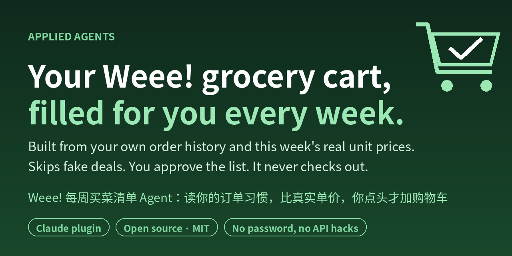

<p align="center">
  
</p>

# Weee! Grocery Autopilot

**A Claude agent that does your weekly Weee! shopping list. It learns from your own order history, uses this week's real unit prices (not discount labels), fills your cart after you say yes, and never checks out.**

**给 Weee! 用户：每周自动出买菜清单、加进购物车的 Agent。读你自己的历史订单，比真实单价，你确认后才加购物车，永远不帮你下单。**

Plugin name: `grocery-autopilot` · Part of [Applied Agents](../../README.md) · Weee! supported today, other stores via [adapters](#add-your-store).

## Is this for you?
- You order from **Weee!** every week and rebuild roughly the same cart each time.
- You like deals but don't trust the discount labels.
- You want the list in minutes, and you still want to press Order yourself.

## How a week looks
1. **Wednesday (or your shopping day):** say "run grocery autopilot" or let a scheduled task do it.
2. It reads your cart (items already there stay), last week's unordered items, this week's deals and your habits.
3. It shows you a list with a reason for every item, the real unit price, and the total vs. your budget.
4. You say "looks good" or "swap the pork". It fills the cart. **You** place the order.

<!-- Demo GIF goes here: docs/demo.gif (list table -> approval -> filled cart) -->

## What it does
- **Learns your habits from your own order history**: what you buy, how often, how much you usually pay, which categories you're price-sensitive in, and what you've quietly stopped buying.
- **Builds this week's list**: items that are due, plus real deals on things you actually buy, within your budget.
- **Checks real prices, not discount labels**: compares unit prices ($/lb, $/oz) against comparable items and your own price history, and skips "deals" that are still more expensive.
- **Adds 1–2 new things to try** from brands and categories you already like.
- **Doesn't treat pantry items as weekly**: sauces, rice and other slow-moving items get a reminder instead of landing in your cart every week.
- **Learns from your feedback**: say "never buy X" or "more variety" and the rules change.
- **Fills the Weee! cart only after you approve. Never checks out.**

## Real results (author's own account)
- Read 75 orders over 18 months: 1,110 line items, 476 different products.
- Found the habits: an order about every 6.5 days, ~$80 typical basket; produce bought on a discount ~60% of the time, frozen dumplings rarely (brand-loyal).
- First run: a 16-item, $85 cart in a few minutes. It caught a pear deal labeled "34% OFF" that was still pricier than what the author usually paid, and swapped regular avocados for organic ones that were cheaper that week.

## Install
In Claude Code:
```
claude plugin marketplace add garrycui/applied-agents
claude plugin install grocery-autopilot@applied-agents
```

## First run
Say **"set up grocery autopilot"**. It will:
1. Ask for your store, budget, shopping day, language and how many new items to try.
2. Read your order history in your signed-in browser (you sign in yourself; it never types passwords).
3. Show you a profile of your habits and create your staples list, with one setting per item: `auto`, `deal-only`, `never` or `pantry` (reminder only).

Your data stays with you: a local folder (default `~/grocery-autopilot/`) or your own Project documents. Nothing is sent anywhere else, and nothing goes into this repo.

Every week, say **"run grocery autopilot"**, or schedule it on your shopping day if your Claude app supports scheduled tasks.

## Requirements
- Claude with a browser it can drive where you're signed in to your store: Claude in Chrome, or the Claude desktop app's built-in browser.
- A supported store: **Weee!** today. See [adding a store](#add-your-store).
- Python 3 (optional, for the habit analysis script; Claude can do the math without it).

## Safety by design
- Shows the list first; touches the cart only after you approve.
- Never checks out, places orders, or changes your address, payment or account settings.
- Works only in your own browser session, at human pace. No private API calls with your tokens, no CAPTCHA bypassing, no scraping catalogs for redistribution.

## Add your store
Each store is an adapter in `adapters/<store>/`. Copy [`adapters/TEMPLATE.md`](adapters/TEMPLATE.md), fill in where orders, prices, the cart and the add-to-cart button live, and the skills work unchanged. PRs welcome (H Mart, 99 Ranch, Costco, Instacart…).

## Disclaimer
Not affiliated with, endorsed by or sponsored by Weee! Inc. or any store. You're responsible for complying with your store's terms of service. Prices and page layouts change; check the list before you approve it.

## License
MIT

---
Built by [Gary Cui](https://github.com/garrycui) as part of **Applied Agents**. If it saves you time or money, a ⭐ on the repo helps more people find it.

---

### 中文简介
**按你自己的购买习惯和这周的真实价格，每周出一份买菜清单；你确认后自动加进购物车，永远不帮你下单。**
- 读你自己的历史订单，学会你常买什么、多久买一次、平时付多少钱
- 比单位价，不看折扣标签；"打折但其实更贵"的会被识别出来并跳过
- 每周推荐 1–2 样你常买的品牌和品类里值得试的新东西
- 调料干货不会每周都塞进购物车，只提醒
- 你说"以后不买 X"，规则就跟着改
- 目前支持 Weee!，其他超市可以按模板加
